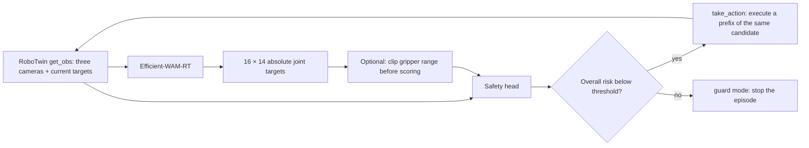

# WAtcher

**Watching Ahead for Safe Robotic Manipulation with Efficient World-Action Models**

[Project page](site/index.html) · Paper (coming soon) · 300-question benchmark (coming soon on Hugging Face)


WAtcher lets a world-action model (WAM) check every candidate action chunk *before* it is executed. A
lightweight, detachable safety head scores the chunk, and risky chunks never reach the simulator.

This repository contains the RoboTwin implementation: the official 14-D Efficient-WAM-RT policy, a
simulation safety head, a synchronous risk gate, and a closed loop that drives a real RoboTwin task.

> **Scope of this code.** The safety head shipped here is the original *06* development checkpoint. It reads
> the current camera views, the robot state and the candidate chunk; it does **not** yet consume imagined
> future frames, and guard mode stops the episode instead of executing a bounded retreat. The Safe-Guard
> training code and the full imagined-outcome pipeline described in the paper are not part of this release
> yet. Numbers on the project page are paper results, not outputs of this repository.

## How it works



Scoring is **synchronous**: every candidate is scored after it is generated and before any of its actions is
sent to the simulator. The loop then executes, re-observes and repeats. Risk is never back-filled on stale
frames.

## Installation

Requirements: Linux, a CUDA-enabled PyTorch build, and an installed RoboTwin with SAPIEN and CuRobo.
The validated RoboTwin commit is `c3ddfa8b97d5519efa828b075999bd0006778e5e`.

```bash
git clone https://github.com/maxiaovivi/WAtcher.git
cd WAtcher
pip install -e '.[safety,wam,dev]'
pytest -q
```

Extras: `safety` (safety head only, CPU is enough), `wam` (Efficient-WAM policy, needs CUDA), `dev` (tests).
This repository does not install drivers, download models, or talk to physical robots. Prepare RoboTwin and
its assets following the RoboTwin instructions.

### Assets

You need, locally:

- the official full `Efficient-WAM-RT_stage3.pt`, the matching RoboTwin `deploy_policy.yml`, the WAN config and
  the VAE;
- a cached text embedding for the task instruction, which must match the full scene prefix plus instruction;
- the original `06_offline/safety-offline.pt`, trained for the profile `robotwin_legacy_target14`.

Fill in local paths following [`examples/wam_assets.example.json`](examples/wam_assets.example.json); relative
paths resolve from the JSON file's directory. See [policy assets](docs/efficient_wam_assets.md) and
[simulation safety head](docs/simulation_safety.md) for details.

## Running a closed-loop episode

The instruction must match the cached text in the asset config, and the object descriptions in the
instruction should match the scene seed.

```bash
watcher-robotwin \
  --robotwin-root /path/to/RoboTwin \
  --task hanging_mug --setting randomized --seed 100033 \
  --policy-seed 310100033 \
  --policy-config /path/to/robotwin_assets.local.json \
  --safety-checkpoint /path/to/06_offline/safety-offline.pt \
  --instruction 'Grab the beige mug, turn it, set it on the table, then hang it on the medium-sized rack.' \
  --device cuda:0 --safety-device cpu \
  --execute-steps 16 --mode guard --gripper-mode clip \
  --output-dir outputs/hanging_mug_guard_01
```

By default the task's official action limit is kept. `--max-actions` is for short diagnostics only; hitting
that artificial limit is not task success. Smaller `--execute-steps` (e.g. `4`) execute a shorter prefix and
re-observe sooner; the full 16-step candidate is still risk-checked first.

`--output-dir` must be a new directory. It receives a compact `risk_events.jsonl` and a `summary.json` with
per-chunk risk, whether the chunk was rejected, the number of simulator actions actually executed, and the
native `task_success`. No video or images are saved by default.

### Execution modes

| Mode | Behavior |
|---|---|
| `guard` (default) | Stops the episode when risk reaches the threshold; the rejected candidate is not executed. |
| `monitor` | Simulation-only comparison: after valid scoring, the candidate is executed even if high-risk. The log keeps `REJECT` and sets `high_risk_executed_in_monitor`. |

Both modes stop on invalid input, NaNs or inference errors. `monitor` is for comparing predictions with
outcomes in simulation and provides no protection. There is no automatic "lift up" or any other unchecked
fallback motion.

### Gripper range

RoboTwin's native `set_gripper` clips to `[0, 1]`. To make the scored action identical to the executed one,
pass `--gripper-mode clip`: columns 6 and 13 are clipped **first**, then the same candidate is scored and
executed, and the number of modified values is logged. The 12 joint targets are never changed. The default
`strict` mode rejects out-of-range gripper values.

## Data contract

| Item | Definition |
|---|---|
| Cameras | Current head, left and right uint8 RGB; native keys `head_camera`, `left_camera`, `right_camera` |
| Policy images | Official 360×320 three-view mosaic, padded to 384×320; head image is 240×320 |
| Safety-head images | Each original camera image resized independently to 128×128 with PIL BILINEAR |
| State | `get_obs()['joint_action']['vector']`: the current drive-target proxy, not measured qpos |
| Candidate | `[16, 14]` absolute joint targets: left arm 6 + left gripper + right arm 6 + right gripper |
| Units | Joints in rad; gripper **1 = open, 0 = closed** |
| Execution | Native `take_action(target14, action_type='qpos')`; TOPP decides interpolation and duration |
| Safety-head timing | Keeps the training-time `unknown_duration`; no fixed 0.06 s action interval is assumed |

The policy uses the qpos mean/std stored in the official checkpoint for normalization and de-normalization.
The safety head takes physical values and normalizes them once with its own statistics. Do not normalize
inputs twice, and do not substitute measured qpos, end-effector poses or velocities for the drive targets.

## Python API

```python
from safe_wam import GuardedSimulationPolicy, run_episode
from safe_wam.simulation_policy import SimulationEfficientWAMPolicy
from safe_wam.simulation_safety import SimulationSafetyHead

policy = SimulationEfficientWAMPolicy('robotwin_assets.local.json', device='cuda:0')
policy.reset(seed=17)
head = SimulationSafetyHead('safety-offline.pt', device='cpu')
controller = GuardedSimulationPolicy(head, policy, gripper_mode='clip')

# `task` is a native RoboTwin task after setup_demo, with the same instruction set.
result = run_episode(task, controller, instruction, execute_steps=16, mode='guard')
print(result['status'], result['task_success'], result['risk_evaluations'])

# Score an external 16x14 absolute-target candidate without running the simulator.
decision = GuardedSimulationPolicy(head).evaluate(task.get_obs(), instruction, actions=targets)
```

## Validation and limitations

See the [validation record](docs/VALIDATION.md): 45 interface tests pass, and all 18 probabilities of the
original 06 safety head match the new adapter exactly (max difference 0.0) on a real input on CPU.

Both modes were run end to end in a real RoboTwin `hanging_mug` scene. `guard` executed 96 actions and scored
7 times before rejecting a high-risk candidate; `monitor` ran to the official 900-action limit with 57
evaluations. **Neither episode completed the task.** This validates the execution, scoring and rejection path,
not task success or hazard-detection accuracy.

The risk output has 16 per-step values, a `post` value and their overall maximum; `post` must not be dropped.
Per-step risk timing has not been independently validated, and fixed-chunk execution is not automatically
equivalent to the timing of the sampled training trajectories. `ALLOW` is a model prediction, not a safety
guarantee.

## 300-question benchmark

The frozen Test300 benchmark (100 hazardous + 200 normal cases; 204 RoboTwin, 96 LIBERO) will be released on
Hugging Face. It is intentionally not stored in this repository. It is an evaluation set only: do not train
or tune on it.

## Project page

[`site/`](site/) is the static project page (plain HTML, no build step). Preview it locally with:

```bash
python3 -m http.server 8000 --directory site   # open http://localhost:8000/
```

## Repository layout

```text
src/safe_wam/
  simulation_policy.py     official RoboTwin Efficient-WAM policy
  simulation_safety.py     original 06 simulation safety head
  simulation_pipeline.py   risk gate on one observation and one candidate
  simulation_loop.py       get_obs -> score -> take_action closed loop
  robotwin_env.py          native task setup in an isolated process
  robotwin_cli.py          `watcher-robotwin` entry point
  vendor/                  pinned minimal inference dependencies
src/safety_verify_wam/     numerical implementation of the original safety head
tests/                     contract, gating, execution-order and equivalence checks
docs/                      asset, safety-head and validation notes
site/                      project page
```

## License

See [LICENSE](LICENSE). Upstream licenses and provenance are listed in
[THIRD_PARTY_NOTICES.md](THIRD_PARTY_NOTICES.md).
