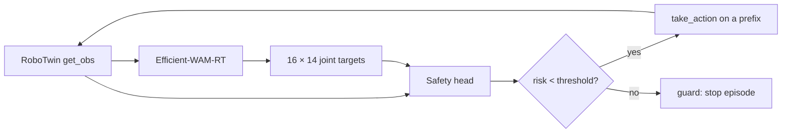

<div align="center">

# WAtcher

### Watching Ahead for Safe Robotic Manipulation with Efficient World-Action Models

[**Project page**](https://zyshan0929.github.io/WAtcher/) · **Paper** (coming soon) · [**300Question-Bench**](#300question-bench) (coming soon)

</div>


WAtcher lets a world-action model (WAM) **check every candidate action chunk before it is executed**. The WAM
proposes a chunk; a lightweight, detachable **Safe-Guard** scores it; risky chunks never reach the robot.

## Contents

1. [Installation](#1-installation)
2. [Train the WAM](#2-train-the-wam)
3. [Train Safe-Guard](#3-train-safe-guard)
4. [Run WAtcher in RoboTwin](#4-run-watcher-in-robotwin)
5. [300Question-Bench](#300question-bench)
6. [Repository layout](#repository-layout) · [Citation](#citation) · [License](#license)

> **Release status.** This release contains the RoboTwin closed loop: the 14-D Efficient-WAM-RT policy, a
> simulation safety head, a synchronous risk gate and the `watcher-robotwin` runner. The shipped safety head is
> the *06* development checkpoint: it reads the current views, state and candidate chunk, but not yet the
> imagined future frames, and `guard` mode stops the episode instead of executing a bounded retreat. Safe-Guard
> training code, the hazard dataset and the full imagined-outcome pipeline will follow.

---

## 1. Installation

WAtcher uses two environments: one to **train** the WAM (Efficient-WAM's) and one to **run** WAtcher in
RoboTwin. Linux and CUDA GPUs are required for both; the safety head alone runs on CPU.

### 1.1 Simulation / inference environment

1. Install [RoboTwin 2.0](https://github.com/RoboTwin-Platform/RoboTwin) with SAPIEN and CuRobo, following its
   instructions, and download its assets. WAtcher was validated with RoboTwin commit
   `c3ddfa8b97d5519efa828b075999bd0006778e5e` and the dual `aloha-agilex` embodiment.
2. In the same Python environment (Python ≥ 3.10, CUDA-enabled PyTorch ≥ 2.4), install WAtcher:

```bash
git clone https://github.com/maxiaovivi/WAtcher.git
cd WAtcher
pip install -e '.[safety,wam,dev]'
pytest -q          # interface tests; no GPU, simulator or weights needed
```

Extras: `safety` (safety head), `wam` (Efficient-WAM policy), `dev` (tests). Nothing here downloads weights or
talks to a physical robot.

### 1.2 Training environment

The WAM is trained with the official [Efficient-WAM](https://github.com/jiajun613/Efficient-WAM) code. WAtcher's
vendored inference runtime is taken from commit `2bd75a8c56acfcd5754b98c7ed313176911ccae0`; use that commit so
the exported checkpoints load unchanged.

```bash
git clone https://github.com/jiajun613/Efficient-WAM.git
cd Efficient-WAM
git checkout 2bd75a8c56acfcd5754b98c7ed313176911ccae0
conda env create -f envs/train.yaml
conda activate EfficientWAM
```

You also need [Wan2.2-TI2V-5B](https://huggingface.co/Wan-AI/Wan2.2-TI2V-5B) (teacher, VAE and UMT5 text
encoder).

---

## 2. Train the WAM

WAtcher's policy is the unchanged 14-D Efficient-WAM-RT model. Run these commands inside the Efficient-WAM
checkout from [§1.2](#12-training-environment). First replace the placeholder paths in `configs/robotwin/*.yaml`
(dataset roots, Wan2.2 path, output directories).

**Data.** Download RoboTwin 2.0 demonstrations and convert them to the Efficient-WAM format:

```bash
bash scripts/robotwin/download_robotwin_dataset.sh
bash scripts/robotwin/convert_robotwin_dataset.sh
python scripts/robotwin/build_train_dataset.py --config configs/robotwin/train_dataset.yaml
python scripts/robotwin/prepare_stage1_pca.py --config configs/robotwin/stage1_pca_prep.yaml
```

**Training.** Three stages; `scripts/train.sh` defaults to 8 GPUs on one node (`NUM_GPUS`, `NUM_NODES`, ...
override this).

```bash
STAGE=stage1 bash scripts/train.sh   # compact video expert distillation
STAGE=stage2 bash scripts/train.sh   # action expert on the frozen video expert
STAGE=stage3 bash scripts/train.sh   # joint video-action training
```

Set `compact_wan_checkpoint` (stage 1 output) and `action_init_checkpoint` (stage 2 output) in
`configs/robotwin/stage3_joint.yaml` before stage 3. Stage 3 exports `stage3_step_<N>.pt`, a single file with
`model` and `config`: this is the `checkpoint` WAtcher loads. The model must keep the official contract
(14-D state/action, 16-action chunks, 384×320 input mosaic); WAtcher refuses any other shape.

**Text cache.** WAtcher never runs the 5B text encoder at run time. Precompute the UMT5 embedding of each task
instruction once, from the Efficient-WAM checkout:

```bash
python /path/to/WAtcher/scripts/make_text_cache.py \
  --wan-root /path/to/Wan2.2-TI2V-5B \
  --instruction 'Grab the beige mug, turn it, set it on the table, then hang it on the medium-sized rack.' \
  --output /path/to/assets/text/hanging_mug.pt
```

**Asset file.** Point WAtcher at your weights by copying
[`examples/wam_assets.example.json`](examples/wam_assets.example.json) to e.g. `robotwin_assets.local.json`
(relative paths resolve from the JSON's directory):

| Key | Value |
|---|---|
| `checkpoint` | Stage 3 export (or the official `Efficient-WAM-RT_stage3.pt`) |
| `deploy_config` | `inference/robotwin/EfficientWAM/deploy_policy.yml` from Efficient-WAM |
| `wan_directory` | Directory with Wan2.2 `config.json` and `Wan2.2_VAE.pth` |
| `text_embeddings` | The cache built above |
| `instruction` | Exactly the instruction in that cache |

See [docs/efficient_wam_assets.md](docs/efficient_wam_assets.md) for the full policy contract.

---

## 3. Train Safe-Guard

> 🚧 **Coming soon.** The Safe-Guard training code and the hazard dataset (~25k physically labeled candidate
> windows from RoboTwin, LIBERO and a UR7e) will be released here. Until then, WAtcher runs with the original
> 06 checkpoint `06_offline/safety-offline.pt` (profile `robotwin_legacy_target14`).

The release will cover:

1. **Hazard data collection.** Perturb expert demonstrations, execute every candidate chunk and label it from
   recorded physical events (contacts, loss of support, ...).
2. **Training.** Train Safe-Guard (1.7M parameters) on views, state, candidate commands and imagined frames.
3. **Evaluation.** Blind set and [300Question-Bench](#300question-bench).

How the current head reads its inputs and the checkpoint contract it must satisfy are documented in
[docs/simulation_safety.md](docs/simulation_safety.md).

---

## 4. Run WAtcher in RoboTwin

```bash
watcher-robotwin \
  --robotwin-root /path/to/RoboTwin \
  --task hanging_mug --setting randomized --seed 100033 \
  --policy-seed 310100033 \
  --policy-config /path/to/robotwin_assets.local.json \
  --safety-checkpoint /path/to/06_offline/safety-offline.pt \
  --instruction 'Grab the beige mug, turn it, set it on the table, then hang it on the medium-sized rack.' \
  --device cuda:0 --safety-device cpu \
  --execute-steps 16 --mode guard --gripper-mode clip \
  --output-dir outputs/hanging_mug_guard_01
```

Each loop iteration observes, generates a 16×14 candidate, scores it, and only then executes a prefix of it:



| Option | Meaning |
|---|---|
| `--mode guard` | Default. Stop when risk reaches the threshold; the rejected chunk is not executed. |
| `--mode monitor` | Simulation-only comparison: execute even high-risk chunks, logged as `high_risk_executed_in_monitor`. No protection. |
| `--execute-steps N` | Execute the first `N` (1–16) actions, then re-observe. The full chunk is always scored first. |
| `--gripper-mode clip` | Clip gripper columns 6 and 13 to `[0,1]` *before* scoring, so the scored and executed actions are identical. `strict` (default) rejects out-of-range values. |
| `--max-actions N` | Short diagnostic runs only; reaching it is not task success. |

The instruction must match the text cache exactly. `--output-dir` must be new; it receives
`risk_events.jsonl` (per-chunk risk, decision, executed actions) and `summary.json` (including native
`task_success`). Invalid inputs, NaNs and inference errors always stop the episode.

**Python API**

```python
from safe_wam import GuardedSimulationPolicy, run_episode
from safe_wam.simulation_policy import SimulationEfficientWAMPolicy
from safe_wam.simulation_safety import SimulationSafetyHead

policy = SimulationEfficientWAMPolicy('robotwin_assets.local.json', device='cuda:0')
head = SimulationSafetyHead('safety-offline.pt', device='cpu')
controller = GuardedSimulationPolicy(head, policy, gripper_mode='clip')

result = run_episode(task, controller, instruction, execute_steps=16, mode='guard')  # native RoboTwin task
decision = GuardedSimulationPolicy(head).evaluate(task.get_obs(), instruction, actions=targets)  # score only
```

Input conventions (cameras, units, normalization) are listed in [docs/simulation_safety.md](docs/simulation_safety.md)
and [docs/efficient_wam_assets.md](docs/efficient_wam_assets.md); the validated runs are recorded in
[docs/VALIDATION.md](docs/VALIDATION.md). `ALLOW` is a model prediction, not a safety guarantee.

---

## 300Question-Bench

A frozen benchmark of **300 single-decision questions**: given the current views, robot state, task and one
candidate action chunk, will executing it cause a physical hazard? 100 hazardous and 200 normal cases over
18 tasks (204 RoboTwin, 96 LIBERO), each labeled from recorded physical events.

> 🚧 The dataset will be hosted on Hugging Face. The link below is a placeholder until it is uploaded.

```bash
pip install -U huggingface_hub
huggingface-cli download <hf-org>/300Question-Bench --repo-type dataset --local-dir 300Question-Bench
```

Layout:

```text
300Question-Bench/
  public/MANIFEST.json          case list: id, environment, task, robot profile, input path
  public/blind/<case_id>/       input.json (task, constraints, state, candidate) + current-view PNGs
  private/LABELS.json           ground truth: hazardous or not, per case
  private/cases/<case_id>/      future rollout video and physical evidence
```

Models may read only `public/`. Report hazard recall, normal false-positive rate and balanced accuracy: the
all-normal baseline already reaches 66.7% accuracy. **The benchmark is for evaluation only; do not train or tune
on it.**

---

## Repository layout

```text
src/safe_wam/
  simulation_policy.py     Efficient-WAM-RT policy (lazy, cached text, 16×14 targets)
  simulation_safety.py     simulation safety head
  simulation_pipeline.py   risk gate: one observation, one candidate, one decision
  simulation_loop.py       get_obs → score → take_action loop
  robotwin_env.py          native RoboTwin task setup
  robotwin_cli.py          `watcher-robotwin` entry point
  vendor/                  pinned Efficient-WAM inference runtime
src/safety_verify_wam/     safety-head model implementation
scripts/make_text_cache.py instruction embedding cache
tests/                     contract, gating and execution-order tests
docs/                      policy, safety-head and validation notes
site/                      project page (static HTML)
```

## Citation

```bibtex
@misc{shan2026watcher,
  title={{WAtcher}: Watching Ahead for Safe Robotic Manipulation with Efficient World-Action Models},
  author={Shan, Ziyu and Ma, Xiao and Yu, Kangrui and Wang, Changjie and
          Wu, Gaoyuan and Yang, Zaijia and Zhang, Chuanrui and Li, Qirui and
          Zhang, Yanbo and Wang, Duomin and Wang, Ziwei},
  year={2026},
  howpublished={\url{https://zyshan0929.github.io/WAtcher/}}
}
```

## License

See [LICENSE](LICENSE). WAtcher builds on [Efficient-WAM](https://github.com/jiajun613/Efficient-WAM) and
[Wan2.2](https://github.com/Wan-Video/Wan2.2); upstream licenses are listed in
[THIRD_PARTY_NOTICES.md](THIRD_PARTY_NOTICES.md).
