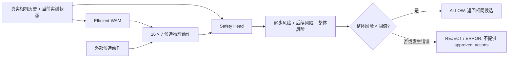

# WAtcher

**Efficient-WAM 动作生成 + 执行前安全头风险预测。**

WAtcher 把已有的 Efficient-WAM 机械臂策略和安全头整理成一个独立的 Python 推理仓库。支持两种入口：由 Efficient-WAM 生成候选动作，或直接输入已有的物理动作序列。两种入口都对同一决策点的真实观测和候选动作进行风险评分。



## 当前可用范围

- 策略：三相机、7维实测状态，输出16步UR基坐标系 `speedL` 候选动作。
- 安全头：已有 `07_offline_plus_real` 的 `ur5_speedl7_velocity_v1` 分支。原 `06_offline` 的 RoboTwin 14维分支不能替代它。
- 整体风险沿用训练模型的 `max(逐步风险, post风险)`，包括候选序列之后的风险；等于阈值时拒绝。
- 无需启动机器人即可运行离线推理。仓库不包含机器人连接、速度下发、夹爪控制或固定上抬回退。

**这份UR安全头仍是研究版本。** 原交付开发集61例：TP17、FN9、FP16、TN19，正确率59.0%，危险召回65.4%，误报率45.7%。这不是独立测试或机器人任务成功率。逐动作步风险尚未获得有效标签验证，不能据此声称已实现可靠的接触前预警。最近在 RoboTwin / LIBERO 上做的改进不代表这个UR分支具有同样性能；本仓库不自动替换成实验性仿真权重。

`ALLOW` 仅表示候选通过模型阈值，**不授权机器人执行**。真实控制器仍需完成自己的限位、速度、碰撞和急停检查。对动作做限幅、坐标变换、夹爪离散化或截断后，应按最终动作重新评估；不能沿用修改前的判断。

WAM可能输出略超出[0,1]的夹爪值。本仓库默认 `gripper_mode="strict"`，直接拒绝这种输入；可显式选择 `gripper_mode="clip"` / `--gripper-mode clip`，**先**限制夹爪范围，再评估并返回同一组修改后的候选。输出 `action_processing` 会报告该模式和修改数量。它不改变平移或旋转速度，也不做夹爪二值化。这是可选的执行前动作处理，不是原策略的数值等价输出。

## 安装

建议 Python 3.10/3.11。先根据机器CUDA环境安装对应的 PyTorch，再安装所需部分：

```bash
python -m venv .venv
source .venv/bin/activate
pip install -e '.[safety,wam,dev]'
pytest -q
```

仅接收外部动作并做安全评分时，安装 `.[safety]` 即可，不加载 Efficient-WAM 或它的大型基础权重。基础安装 `pip install -e .` 只包含输入合同、门控组合和文件接口，不会自动下载模型。

## 权重与配置

权重、录像、训练数据和凭据不进入Git。

1. 准备原 `07_offline_plus_real/safety-offline-plus-real.pt`。原有安全头的归一化统计包含在checkpoint中。
2. 如需由WAM生成动作，准备受支持的任务导出、官方基础权重、WAN VAE和任务文本嵌入；填写 [WAM配置](examples/wam_assets.example.json)。详见 [Efficient-WAM依赖说明](docs/efficient_wam_assets.md)。
3. 安全头的实际接口及版本限制见 [安全头说明](docs/safety_head.md)。本仓库包含推理代码，不包含大型模型权重，也不把差量任务权重称为独立完整模型。

## 输入合同

| 输入 | 要求 |
|---|---|
| 相机 | `external`、`hand`、`hand2`，uint8 RGB原图；相机可有不同原始分辨率 |
| 相机历史 | 4组真实、多视角对齐的观测，按时间从旧到新排列；不能复制当前帧凑历史 |
| 状态 | 当前实测 `[q0, q1, q2, q3, q4, q5, gripper_feedback]`；关节单位rad，夹爪反馈范围[0,1] |
| 动作 | `[16,7]`，每行为 `[vx,vy,vz,wx,wy,wz,gripper_command]`；平移m/s，旋转rad/s，UR基坐标系，夹爪范围[0,1] |
| 时间 | 观测和状态时间相对于同一个决策时刻，单位秒、非正；观测时间严格递增 |

状态中的夹爪反馈与动作中的夹爪命令含义不同，不能互换。WAM自行做任务归一化和一次反归一化；安全头接收物理值，再用自己的统计归一化一次。两者各自从原始RGB进行训练时对应的图像预处理。

本版安全头未验证动作执行时长，沿用 `unknown_duration`。WAM的训练帧率不等于已经验证的机器人执行频率。来自其他策略的16×7数组也必须核对动作含义，不能仅凭形状相同接入。

## Python调用

```python
from safe_wam import Frame, Observation, GuardedPolicy
from safe_wam.safety_head import SafetyHead
from safe_wam.efficient_wam import EfficientWAMPolicy

# frames: 4个真实Frame；images包含external/hand/hand2的uint8 RGB数组。
# measured_state: 实测7维状态，绝不是预测状态或TCP位置。
observation = Observation(tuple(frames), measured_state, state_timestamp_s=-0.005)
head = SafetyHead('weights/safety-offline-plus-real.pt', device='cpu')
wam = EfficientWAMPolicy('wam.local.json', device='cuda:0')

decision = GuardedPolicy(head, wam).evaluate(observation)
print(decision.to_dict())
# decision.approved_actions 在拒绝或错误时为None；这里不会执行机器人。

# 外部候选：绕过WAM，仍使用同一安全检查。
decision = GuardedPolicy(head).evaluate(observation, actions=physical_actions_16x7)

# 显式选择夹爪范围修正：被评分和返回的都是修正后的同一候选。
decision = GuardedPolicy(head, wam, gripper_mode='clip').evaluate(observation)
```

## JSON命令行

`safe-wam` 读取本地请求文件。每个frame中的图像路径相对于请求文件目录，格式见 [生成动作的请求模板](examples/request.example.json) 和 [外部动作的请求模板](examples/request_with_actions.example.json)。示例中的数值仅说明格式，必须替换成实际观测和待评估动作；不代表安全动作或成功实验。

```bash
# 请求已有actions：不加载WAM。
safe-wam request.json --safety-checkpoint weights/safety-offline-plus-real.pt \
  --output decision.json

# 请求没有actions：用WAM生成后评估。
safe-wam request.json --safety-checkpoint weights/safety-offline-plus-real.pt \
  --wam-config wam.local.json --output decision.json

# 若主动选择夹爪范围修正，在上述命令中加 --gripper-mode clip。
```

输出包含 `candidate_actions`、`approved_actions`、16个step风险、post风险、整体风险、阈值和状态。`REJECT`是有效模型判断，CLI退出码为0；非法输入或推理错误退出码为2。输出文件使用新建模式，避免覆盖实验记录。

## 代码结构

```text
src/safe_wam/               输入合同、组合门控、CLI、模型adapter
src/safety_verify_wam/      原安全头最小推理依赖
src/safe_wam/vendor/        固定版本的Efficient-WAM推理依赖
examples/                  权重配置与请求模板
tests/                     门控、输入、预处理与adapter测试
docs/                      权重来源、接口限制和实际验证记录
```

开发者应先运行离线测试，避免把测试替身产生的风险分数当成真实模型指标。已执行的检查及尚未验证的部分见 [验证记录](docs/VALIDATION.md)。上游来源与许可证见 [第三方说明](THIRD_PARTY_NOTICES.md)。
