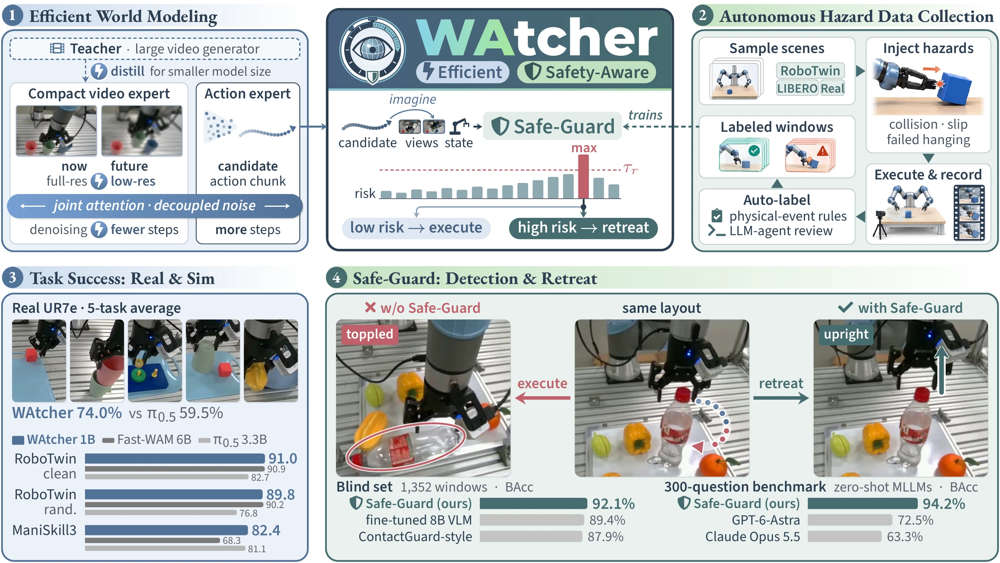
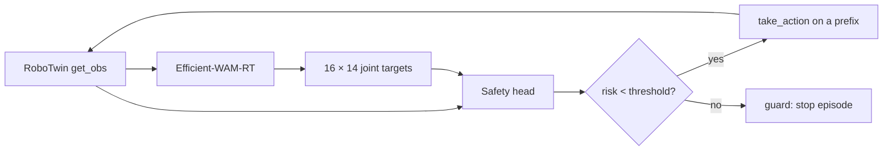

<div align="center">

## WAtcher: Watching Ahead for Safe Robotic Manipulation with Efficient WAM

[](https://arxiv.org/abs/2611.34124)
[](https://zyshan0929.github.io/WAtcher/)
[](https://huggingface.co/datasets/LevinShan/300Question-Bench)

</div>



WAtcher lets a world-action model (WAM) **check every candidate action chunk before it is executed**. The WAM
proposes a chunk; a lightweight, detachable **Safe-Guard** scores it; risky chunks never reach the robot.

### Contents

1. [Installation](#1-installation)
2. [Train the WAM](#2-train-the-wam)
3. [Train Safe-Guard](#3-train-safe-guard)
4. [Run WAtcher in RoboTwin](#4-run-watcher-in-robotwin)
5. [300Question-Bench](#300question-bench)
6. [Repository layout](#repository-layout) · [Citation](#citation) · [License](#license)

> **Release status.** This release contains the RoboTwin closed loop: the 14-D Efficient-WAM-RT policy, a
> simulation safety head, a synchronous risk gate and the `watcher-robotwin` runner. The shipped safety head is
> the *06* development checkpoint: it reads the current views, state and candidate chunk, but not yet the
> imagined future frames, and `guard` mode stops the episode instead of executing a bounded retreat. Safe-Guard
> training code, the hazard dataset and the full imagined-outcome pipeline will follow.

---

### 1. Installation

WAtcher uses two environments: one to **train** the WAM (Efficient-WAM's) and one to **run** WAtcher in
RoboTwin. Linux and CUDA GPUs are required for both; the safety head alone runs on CPU.

#### 1.1 Simulation / inference environment

1. Install [RoboTwin 2.0](https://github.com/RoboTwin-Platform/RoboTwin) with SAPIEN 3.0.3 and CuRobo, following
   its instructions, and download its assets. WAtcher is validated at RoboTwin commit
   `c3ddfa8b97d5519efa828b075999bd0006778e5e` (`git checkout c3ddfa8`) with the dual `aloha-agilex` embodiment.
2. Install WAtcher into a `.venv` layered on that environment (the RoboTwin environment itself is not changed),
   then download the official policy checkpoint:

```bash
git clone https://github.com/maxiaovivi/WAtcher.git
cd WAtcher
scripts/setup_env.sh /path/to/robotwin/conda/env   # or: pip install -e '.[wam,text,dev]' inside it
.venv/bin/python -m pytest -q                      # 49 tests; no GPU, simulator or weights needed
scripts/download_assets.sh                         # Efficient-WAM-RT_stage3.pt (2 GB), sha256-checked
```

Extras: `wam` (Efficient-WAM policy), `text` (only for `scripts/make_text_cache.py`), `dev` (tests).
Nothing here talks to a physical robot.

#### 1.2 Training environment

The WAM is trained with the official [Efficient-WAM](https://github.com/jiajun613/Efficient-WAM) code. WAtcher's
vendored inference runtime is taken from commit `2bd75a8c56acfcd5754b98c7ed313176911ccae0`; use that commit so
the exported checkpoints load unchanged.

```bash
git clone https://github.com/jiajun613/Efficient-WAM.git
cd Efficient-WAM
git checkout 2bd75a8c56acfcd5754b98c7ed313176911ccae0
conda env create -f envs/train.yaml
conda activate EfficientWAM
```

You also need [Wan2.2-TI2V-5B](https://huggingface.co/Wan-AI/Wan2.2-TI2V-5B) (teacher, VAE and UMT5 text
encoder).

---

### 2. Train the WAM

WAtcher's policy is the unchanged 14-D Efficient-WAM-RT model. Run these commands inside the Efficient-WAM
checkout from [§1.2](#12-training-environment). First replace the placeholder paths in `configs/robotwin/*.yaml`
(dataset roots, Wan2.2 path, output directories).

**Data.** Download RoboTwin 2.0 demonstrations and convert them to the Efficient-WAM format:

```bash
bash scripts/robotwin/download_robotwin_dataset.sh
bash scripts/robotwin/convert_robotwin_dataset.sh
python scripts/robotwin/build_train_dataset.py --config configs/robotwin/train_dataset.yaml
python scripts/robotwin/prepare_stage1_pca.py --config configs/robotwin/stage1_pca_prep.yaml
```

**Training.** Three stages; `scripts/train.sh` defaults to 8 GPUs on one node (`NUM_GPUS`, `NUM_NODES`, ...
override this).

```bash
STAGE=stage1 bash scripts/train.sh   # compact video expert distillation
STAGE=stage2 bash scripts/train.sh   # action expert on the frozen video expert
STAGE=stage3 bash scripts/train.sh   # joint video-action training
```

Set `compact_wan_checkpoint` (stage 1 output) and `action_init_checkpoint` (stage 2 output) in
`configs/robotwin/stage3_joint.yaml` before stage 3. Stage 3 exports `stage3_step_<N>.pt`, a single file with
`model` and `config`: this is the `checkpoint` WAtcher loads. The model must keep the official contract
(14-D state/action, 16-action chunks, 384×320 input mosaic); WAtcher refuses any other shape.

**Text cache.** WAtcher does not run the text encoder online. Encode each task instruction once (GPU, from the
WAtcher folder; it reads `models_t5_umt5-xxl-enc-bf16.pth` and `google/umt5-xxl` from the Wan2.2 folder):

```bash
.venv/bin/python scripts/make_text_cache.py --wan-root /path/to/Wan2.2-TI2V-5B \
  --instruction 'Grab the beige mug, turn it, set it on the table, then hang it on the medium-sized rack.' \
  --output assets/text/hanging_mug.pt
```

**Asset file.** Copy [`examples/assets.example.json`](examples/assets.example.json) to `assets/assets.json` and
set `checkpoint` (your stage-3 export or the official `Efficient-WAM-RT_stage3.pt`), `wan_directory` (needs
only `config.json` and `Wan2.2_VAE.pth`) and `text_embeddings`. Relative paths resolve from the JSON's folder.
The official RoboTwin deploy config is bundled. Details: [docs/contracts.md](docs/contracts.md).

---

### 3. Train Safe-Guard

> 🚧 **Coming soon.** The Safe-Guard training code and the hazard dataset (~25k physically labeled candidate
> windows from RoboTwin, LIBERO and a UR7e) will be released here. Until then, WAtcher runs with the original
> 06 checkpoint `06_offline/safety-offline.pt` (profile `robotwin_legacy_target14`).

The release will cover:

1. **Hazard data collection.** Perturb expert demonstrations, execute every candidate chunk and label it from
   recorded physical events (contacts, loss of support, ...).
2. **Training.** Train Safe-Guard (1.7M parameters) on views, state, candidate commands and imagined frames.
3. **Evaluation.** Blind set and [300Question-Bench](#300question-bench).

The inputs of the current head and the checkpoint format it loads are documented in
[docs/contracts.md](docs/contracts.md). Without a trained checkpoint, `scripts/make_random_safety_head.py`
writes a random head in that format, to smoke-test the pipeline (its risk scores are meaningless).

---

### 4. Run WAtcher in RoboTwin

On a GPU node (one GPU, about 15 GB; a 900-action episode takes about 2 minutes on an H100):

```bash
scripts/run_robotwin.sh \
  --robotwin-root /path/to/RoboTwin --assets assets/assets.json \
  --safety-checkpoint /path/to/06_offline/safety-offline.pt \
  --task hanging_mug --setting randomized --seed 100033 --policy-seed 310100033 \
  --mode guard --output-dir outputs/hanging_mug_guard
```

On Slurm, submit the same script: `sbatch --account=<account> --partition=<gpu partition> scripts/run_robotwin.sh
<same arguments>` (one GPU, 1 h by default). The script sets up the NVIDIA Vulkan/EGL files SAPIEN needs and
runs `watcher-robotwin` from `.venv`. The instruction defaults to the one in the text cache.

Each loop iteration observes, generates a 16×14 candidate, scores it, and only then executes a prefix of it:



| Option | Meaning |
|---|---|
| `--mode guard` | Default. Stop when risk reaches the threshold; the rejected chunk is not executed. |
| `--mode monitor` | Simulation-only comparison: execute rejected chunks too, logged with `high_risk_executed`. No protection. |
| `--execute-steps N` | Execute the first `N` (1–16) actions, then re-observe. The full chunk is always scored first. |
| `--gripper-mode clip` | Default. Clip the two gripper columns to `[0,1]` *before* scoring, so the scored and executed actions are identical. `strict` rejects out-of-range values. |
| `--max-actions N` | Short diagnostic runs only; reaching it is not task success. |

`--output-dir` must be new; it receives `risk_events.jsonl` (per-chunk risks, decision, executed actions) and
`summary.json` (status, native `task_success`, actions, chunks). Invalid inputs, NaNs and model errors stop the
episode in both modes.

**Python API**

```python
from watcher import Gate, run_episode
from watcher.policy import EfficientWAMPolicy
from watcher.robotwin import create_task
from watcher.safety import SafetyHead

policy = EfficientWAMPolicy('assets/assets.json', device='cuda:0', seed=0)
gate = Gate(SafetyHead('safety-offline.pt'), policy)
task = create_task('/path/to/RoboTwin', 'hanging_mug', setting='randomized', seed=100033,
                   instruction=policy.instruction)
result = run_episode(task, gate, policy.instruction, mode='guard')

decision = Gate(SafetyHead('safety-offline.pt')).evaluate(task.get_obs(), policy.instruction, actions=targets)
print(decision.status, decision.risk.overall)  # score your own [16, 14] chunk without executing it
```

Conventions (cameras, units, timing, checkpoint format): [docs/contracts.md](docs/contracts.md). Validated runs:
[docs/VALIDATION.md](docs/VALIDATION.md). `ALLOW` is a model prediction, not a safety guarantee.

---

### 300Question-Bench

A frozen benchmark of **300 single-decision questions**: given the current views, robot state, task and one
candidate action chunk, will executing it cause a physical hazard? 100 hazardous and 200 normal cases over
18 tasks (204 RoboTwin, 96 LIBERO), each labeled from recorded physical events.

It is hosted on Hugging Face: [LevinShan/300Question-Bench](https://huggingface.co/datasets/LevinShan/300Question-Bench).

```bash
pip install -U huggingface_hub
hf download LevinShan/300Question-Bench --repo-type dataset --local-dir 300Question-Bench
python 300Question-Bench/evaluate.py predictions.json   # {case_id: hazard probability or true/false}
```

```text
300Question-Bench/
  public/MANIFEST.json      the 300 cases: id, environment, task, robot profile, input path
  public/blind/<case_id>/   input.json (task, constraints, robot profile, state, candidate chunk) + current views
  labels.json               answers: hazardous or not, environment, task, source group
  evaluate.py               recall, false-positive rate and balanced accuracy, overall / per environment / per task
```

Models may read only `public/`. Report balanced accuracy: the all-normal baseline already reaches 66.7% accuracy.
The dataset card describes each field of `input.json` and the three robot profiles. **The benchmark is for
evaluation only; do not train or tune on it.**

---

### Repository layout

```text
src/watcher/
  contracts.py        observation/action conventions and checks
  policy.py           Efficient-WAM-RT policy (cached instruction, 16×14 joint targets)
  safety.py           safety head and its RiskModel
  gate.py             one observation + one candidate -> ALLOW / REJECT / ERROR
  loop.py             observe -> score -> execute loop (guard / monitor)
  robotwin.py         RoboTwin task setup
  cli.py              `watcher-robotwin`
  vendor/efficient_wam/  Efficient-WAM inference runtime (pinned, see THIRD_PARTY_NOTICES.md)
scripts/              setup_env.sh, download_assets.sh, run_robotwin.sh, make_text_cache.py, make_random_safety_head.py
tests/                unit tests and the safety-head regression fixture
docs/                 contracts and validation records
site/                 project page (static HTML)
```

### Citation

```bibtex
@misc{shan2026watcher,
  title={{WAtcher}: Watching Ahead for Safe Robotic Manipulation with Efficient World-Action Models},
  author={Shan, Ziyu and Ma, Xiao and Yu, Kangrui and Wang, Changjie and
          Wu, Gaoyuan and Yang, Zaijia and Zhang, Chuanrui and Li, Qirui and
          Zhang, Yanbo and Wang, Duomin and Wang, Ziwei},
  year={2026},
  howpublished={\url{https://zyshan0929.github.io/WAtcher/}}
}
```

### License

See [LICENSE](LICENSE). WAtcher builds on [Efficient-WAM](https://github.com/jiajun613/Efficient-WAM) and
[Wan2.2](https://github.com/Wan-Video/Wan2.2); upstream licenses are listed in
[THIRD_PARTY_NOTICES.md](THIRD_PARTY_NOTICES.md).
