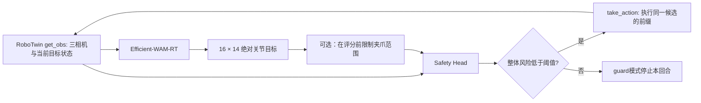

# WAtcher

**在 RoboTwin 中执行 Efficient-WAM 任务，并在每段动作执行前评估风险。**

当前主分支是 **RoboTwin-only**：官方 Efficient-WAM-RT 14维策略、原始仿真安全头、同步风险门控和实际模拟器执行循环。代码、许可证和测试保存在仓库；模型权重、场景资产和实验数据由本地配置提供。



这里的“同时评估”是**每次生成候选后、发送到模拟器前同步评分**，之后再执行和重新观测。它不是拿旧画面在后台补打风险分数。

## 安装和资产

在已安装 RoboTwin、SAPIEN、CuRobo 和适配CUDA版PyTorch的Linux环境中：

```bash
git clone https://github.com/maxiaovivi/WAtcher.git
cd WAtcher
pip install -e '.[safety,wam,dev]'
pytest -q
```

RoboTwin及其资产需按项目本身的安装说明准备；本仓库不会自动安装驱动、下载模型或启动物理机器人。实测环境的RoboTwin版本为 `c3ddfa8b97d5519efa828b075999bd0006778e5e`。

准备：

- 官方完整 `Efficient-WAM-RT_stage3.pt`、匹配的RoboTwin `deploy_policy.yml`、WAN配置与VAE。
- 对应任务指令的缓存文本嵌入；它必须与完整scene prefix及instruction一致。
- 原 `06_offline/safety-offline.pt`，其受训练profile为 `robotwin_legacy_target14`。

按 [资产配置示例](examples/wam_assets.example.json) 填写本地路径。相对路径从该JSON所在目录解析。详见 [策略资产说明](docs/efficient_wam_assets.md) 与 [仿真安全头说明](docs/simulation_safety.md)。

## 跑真实仿真闭环

下面指令必须与配置中的缓存文本一致；场景seed与指令中的物体描述也应匹配。

```bash
watcher-robotwin \
  --robotwin-root /path/to/RoboTwin \
  --task hanging_mug --setting randomized --seed 100033 \
  --policy-seed 310100033 \
  --policy-config /path/to/robotwin_assets.local.json \
  --safety-checkpoint /path/to/06_offline/safety-offline.pt \
  --instruction 'Grab the beige mug, turn it, set it on the table, then hang it on the medium-sized rack.' \
  --device cuda:0 --safety-device cpu \
  --execute-steps 16 --mode guard --gripper-mode clip \
  --output-dir outputs/hanging_mug_guard_01
```

默认保留任务的官方动作步数上限。`--max-actions` 可用于短程诊断，达到这个人为上限不算任务成功。`--execute-steps 4` 等设置会执行候选前缀后更早重新观测；完整16步候选仍先接受风险检查。

输出目录必须是新目录，包含小型 `risk_events.jsonl` 和 `summary.json`。记录包括每段风险、是否被拒绝、实际执行的模拟器动作数，以及原生 `task_success`。默认不保存录像或图像。

### 两种执行模式

| 模式 | 行为 |
|---|---|
| `guard`（默认） | 风险达到阈值时停止回合，不执行被拒绝的候选 |
| `monitor` | 仿真比较模式：完成有效评分后继续执行候选，包括高风险候选；日志保留REJECT和 `high_risk_executed_in_monitor` |

两种模式遇到非法输入、NaN或推理错误都会停止。`monitor`用于在模拟器中观察预测与实际结果，不提供风险拦截。代码没有自动“向上抬升”或其它未经检查的回退动作。

### 夹爪范围处理

RoboTwin原生 `set_gripper` 会限制到 `[0,1]`。为使被评分动作与实际接收动作一致，可显式使用 `--gripper-mode clip`：**先**处理第6、13列，再评分和执行同一候选，并记录修改数量。12个关节目标保持不变。默认 `strict` 会拒绝超界夹爪值。

## 数据合同

| 项目 | 定义 |
|---|---|
| 相机 | 当前时刻的head、left、right三幅uint8 RGB；原生key为head_camera、left_camera、right_camera |
| 策略图像 | 官方360×320三视角拼图，再padding至384×320；head原图240×320 |
| 安全头图像 | 从同一原图独立做PIL BILINEAR至每相机128×128 |
| 状态 | `get_obs()['joint_action']['vector']`，当前drive-target代理，不是实测qpos |
| 候选动作 | `[16,14]`绝对关节目标；左臂6关节＋左夹爪＋右臂6关节＋右夹爪 |
| 单位 | 关节rad；夹爪 **1=open、0=closed** |
| 执行 | 原生 `take_action(target14, action_type='qpos')`，由TOPP决定插值和时长 |
| 安全头时序 | 保留训练时的 `unknown_duration`，不虚构0.06秒固定动作间隔 |

策略使用官方checkpoint的qpos mean/std归一化和反归一化。安全头接收物理值，并按自己的原统计归一化一次。不可再对输入重复归一化，或把实际qpos、末端坐标、速度替代drive-target输入。

## Python接口

```python
from safe_wam import GuardedSimulationPolicy, run_episode
from safe_wam.simulation_policy import SimulationEfficientWAMPolicy
from safe_wam.simulation_safety import SimulationSafetyHead

policy = SimulationEfficientWAMPolicy('robotwin_assets.local.json', device='cuda:0')
policy.reset(seed=17)
head = SimulationSafetyHead('safety-offline.pt', device='cpu')
controller = GuardedSimulationPolicy(head, policy, gripper_mode='clip')

# task是已完成setup_demo并设置同一instruction的原生RoboTwin task。
result = run_episode(task, controller, instruction, execute_steps=16, mode='guard')
print(result['status'], result['task_success'], result['risk_evaluations'])

# 也可以只评分外部16×14绝对目标；此调用不执行模拟器。
decision = GuardedSimulationPolicy(head).evaluate(task.get_obs(), instruction, actions=targets)
```

## 验证与限制

实际检查结果见 [验证记录](docs/VALIDATION.md)：45项接口测试通过；原06安全头与新adapter的全部18个概率已做真实输入CPU等价核对，最大差0.0。

已在真实RoboTwin `hanging_mug` 场景跑通两种模式：`guard`执行96个动作、评分7次后拦截高风险候选；`monitor`执行到官方900动作上限，持续评分57次。**这两回合均未完成挂杯任务**，目前验证的是执行、评分和拦截链路，不是任务成功率或危险识别准确率。

风险输出包括16个step、post及其整体最大值，不能丢弃post项。当前逐步风险时刻没有独立验证；固定chunk执行与原采样训练轨迹的时序也不能自动视为等价。`ALLOW`是模型预测，不是安全保证。

## 结构

```text
src/safe_wam/
  simulation_policy.py     官方RoboTwin Efficient-WAM
  simulation_safety.py     原06仿真安全头
  simulation_pipeline.py   同一观测和候选的风险门控
  simulation_loop.py       get_obs → score → take_action闭环
  robotwin_env.py          独立进程中的原生任务初始化
  robotwin_cli.py          可直接运行的入口
  vendor/                 固定版本最小推理依赖
src/safety_verify_wam/     原安全头数值实现
tests/                    合同、门控、执行顺序和等价检查
```

上游许可与来源见 [第三方说明](THIRD_PARTY_NOTICES.md)。
